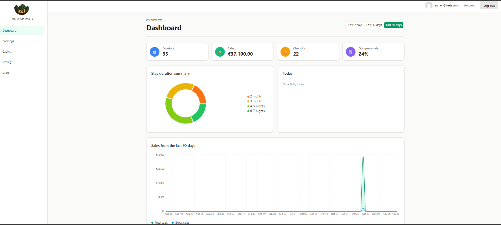
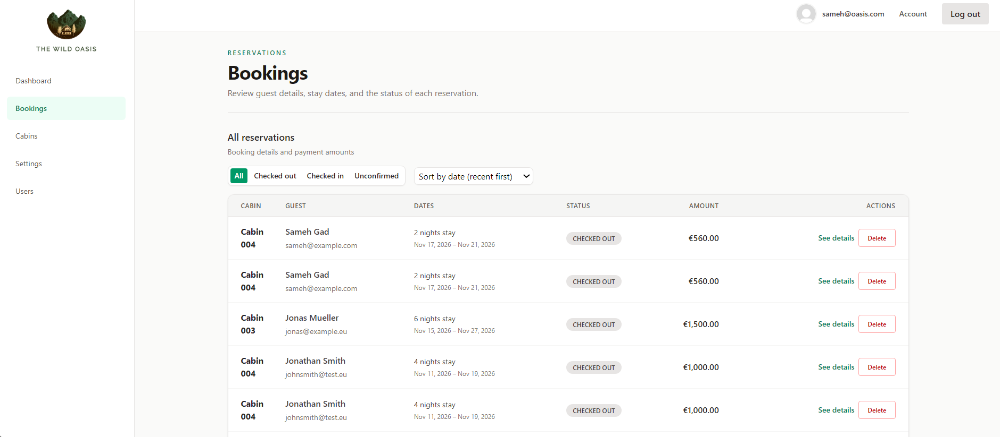
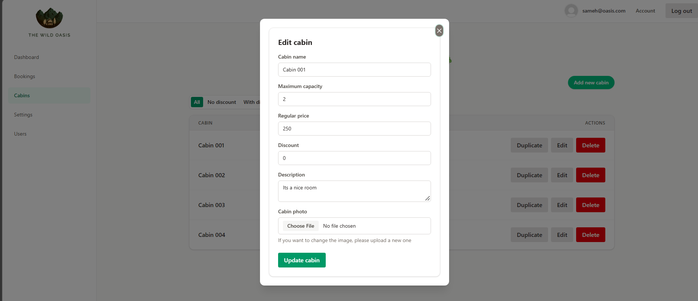

# The Wild Oasis

A hotel management dashboard that helps staff manage daily hotel operations in one place. It provides tools for managing cabins and bookings, handling guest check-ins and check-outs, and monitoring hotel activity through a central dashboard.

## Project Background

This project is an extended implementation of **The Wild Oasis**, originally built as part of [Jonas Schmedtmann's React course](https://jonas.io/courses).

The course project provided the foundation, while this version includes additional improvements, updated dependencies, UI refinements, and custom functionality developed as part of my learning and portfolio work.

## Features

- **Dashboard:** View booking and sales metrics, recent stays, stay-duration analytics, and today's arrivals and departures.
- **Cabin management:** View, create, update, and manage hotel cabins.
- **Booking management:** Browse bookings and view detailed booking information.
- **Guest operations:** Handle guest check-ins and check-outs.
- **Settings and account management:** Manage hotel settings and user account information.
- **Authentication:** Supabase authentication and protected application routes.
- **Server state management:** Data fetching, caching, and synchronization with TanStack Query.

## Screenshots

### Dashboard


### Bookings


### Cabins


## My Improvements

This version builds upon the original course project with the following personal improvements and technical updates:

- **Modernized Styling and Dependencies:** Replaced the course's original styled-components-based styling with Tailwind CSS 4, and upgraded the application to React 19, React Router 7, and TanStack Query 5.
- **More Resilient Pagination:** Added fallback handling for out-of-range booking pages, including retrieving the last available page when records change.
- **Supabase Storage Cleanup:** Improved cabin image management by cleaning up newly uploaded images when operations fail and removing previous images when they are replaced.
- **Modal Accessibility:** Added Escape-key dismissal, keyboard focus trapping, focus restoration, and accessible dialog labels.
- **Reusable UI Components:** Added shared `Input` and `QueryState` components and organized booking details into smaller, focused components.
- **URL Parameter Validation:** Added validation for dashboard date filters and booking filter and sorting parameters before using them in queries.
- **Route-based Code Splitting:** Added lazy-loaded route components to reduce the initial JavaScript payload and load pages on demand.
- **Dashboard Date Handling:** Improved date calculations and local-day boundaries for more consistent dashboard results.
- **Development and Deployment Tooling:** Added Oxlint and Prettier configuration, along with Vercel SPA routing configuration.
- **Custom Branding:** Created a custom SVG favicon for the application.

## Tech Stack

- **React** – UI development
- **Vite** – Development server and build tool
- **React Router** – Client-side routing
- **Supabase** – Database, authentication, and storage
- **TanStack Query** – Server state management and caching
- **Tailwind CSS** – Styling
- **Recharts** – Dashboard charts

## Getting Started

### Prerequisites

- Node.js (LTS recommended)
- npm
- A Supabase project configured with the database, authentication, and storage resources expected by the application.

### Installation

1. Clone the repository:

   ```bash
   git clone https://github.com/Sameh-Gad/the-wild-oasis.git
   ```

2. Navigate to the project directory:

   ```bash
   cd the-wild-oasis
   ```

3. Install dependencies:

   ```bash
   npm install
   ```

### Environment Variables

Create a `.env` file in the project root and add your Supabase credentials:

```env
VITE_SUPABASE_URL=https://your-project.supabase.co
VITE_SUPABASE_KEY=your-supabase-publishable-or-anon-key
```

You can use the provided `.env.example` file as a reference.

**Security note:** This application runs in the browser, so only use a Supabase publishable key (or legacy anon key). Never expose a `service_role` key through a `VITE_` environment variable or commit credentials to the repository.

### Run the Development Server

```bash
npm run dev
```

## Available Scripts

| Command | Description |
| --- | --- |
| `npm run dev` | Start the local development server |
| `npm run build` | Create a production build in `dist/` |
| `npm run preview` | Preview the production build locally |
| `npm run lint` | Run Oxlint |
| `npm run format` | Format source and project configuration files |
| `npm run format:check` | Check formatting |

## Deployment

The application can be deployed to [Vercel](https://vercel.com/).

1. Import the GitHub repository into Vercel.
2. Add `VITE_SUPABASE_URL` and `VITE_SUPABASE_KEY` to the project's environment variables.
3. Deploy the application.

Vercel detects the Vite build settings automatically. The included `vercel.json` rewrite configuration supports the single-page application routing, including direct visits and page refreshes on application routes.

## Project Structure

```text
src/
├── features/       # Feature-specific UI and React Query hooks
├── pages/          # Route-level pages
├── services/       # Supabase client and API functions
├── ui/             # Shared layout and UI components
└── utils/          # Shared utility functions
```